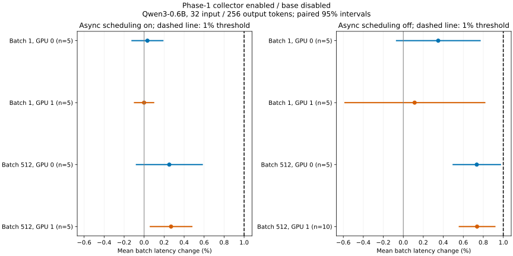
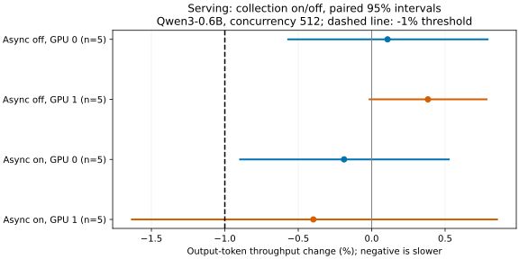

# Scheduled iteration collection benchmark results

Completed 2026-10-13: 290 validated offline runs and 40 validated serving runs
on the two A100 80GB GPUs. Both GPUs were released after the campaign.

## Recommendation

Default-on phase-1 count collection is defensible if maintainers consider the
metrics useful. We see no clear penalty with collection disabled, a small
measurable cost when enabled, and less visible cost with async scheduling.
The performance evidence is encouraging; the remaining decision is whether
the visibility is worth that cost on every deployment.

Most measurements deliberately emphasize small models to expose CPU overhead.
The default-on decision should give particular weight to production workloads
aimed at keeping expensive GPUs busy, where GPU execution and async overlap
can make the same bookkeeping cost less visible. The small-model synchronous
penalty of 0.6-0.7% should not be treated as the expected cost for those
deployments. The 8B async control measured 0.06-0.15%, supporting this distinction,
while leaving larger and multi-GPU production workloads unmeasured.

The provisional 1% target helps assess the measurements. All repeated primary
offline C/A comparisons meet it, while serving and some request-churn results
remain less precise. That uncertainty does not establish an unacceptable
performance cost, and the target is not a universal limit on what observability
may reasonably cost. These benchmarks measure performance, not the operational
benefit of the metrics.

This recommendation covers collection and delivery with verbose output
suppressed. Default collection should be separately controllable from verbose
iteration logging. INFO-level iteration output, new histogram observations and
worker execution timing need their own measurements.

## Plain-language analysis

### Why emphasize small models, and how representative are they?

Most of the GPU measurements, including serving confirmation, use Qwen3-0.6B.
We deliberately use a small model and short prompts to make CPU scheduling
overhead easier to expose. With less GPU work per iteration, extra CPU work
has more opportunity to delay execution. This makes a useful stress test,
although it does not establish that every tested workload was entirely
CPU-bound.

That emphasis serves the measurement, but does not necessarily represent the
production use cases the default-on decision should focus on. A deployment
aimed at maximizing GPU utilization may use a larger model, substantial
contexts and batching, with GPU execution dominating each iteration. Its
visible performance cost can be smaller, especially when async scheduling
overlaps the bookkeeping with GPU work.

Use the small-model results to understand the cost and guard against CPU-sensitive
regressions. Judge default enablement primarily by whether the visibility earns
its performance cost in the production workloads being served. The 8B control
provides some evidence for that judgement; this campaign does not establish a
general production overhead figure.

### What do B/A and C/B tell us?

B/A compares the updated engine with collection disabled against the base
engine with collection disabled. It measures the cost of introducing the new
code while leaving collection off. C/B compares collection enabled against
disabled in the same updated engine. It measures the additional counting,
record construction, timing and delivery work.

Positive numbers below mean longer runtime. The ranges describe measured
averages across cases, rather than confidence bounds.

| Comparison | Measured effect | Interpretation |
| --- | --- | --- |
| B/A: collection disabled, primary tests | About -0.01% to +0.27% | No clear penalty; every confidence interval includes zero. |
| C/B: small model, batch 512, synchronous scheduling | About +0.6-0.7% | A small, repeatable cost. |
| C/B: same workload, async scheduling | About +0.2% | Much of the additional CPU work appears to be hidden. |
| C/B: 8B model, async scheduling | About +0.06-0.15% | The visible cost is smaller with more GPU work. |

The disabled-path differences are comparable to ordinary run-to-run variation.
The tests support the hope that leaving collection off is almost unmeasurable,
without proving its cost is exactly zero. Enabling collection does add CPU work:
the clearest end-to-end result is the 0.6-0.7% synchronous penalty at batch 512.
Async scheduling reduces that to around 0.2%.

The serving tests showed no consistent throughput penalty. Their latency
measurements were too noisy to establish a similarly precise limit. Some
intervals allow regressions above 1%; these are unresolved bounds, rather than
confirmed large regressions. Request-churn results also show no consistent
penalty, with wider uncertainty than the primary tests.

### Would removing `elapsed_ms` change the conclusion?

Probably only modestly. This timer adds two clock reads, arithmetic and storage
of the result. It wraps work the engine already waits for; it does not introduce
another GPU wait or synchronization. Its individual contribution was not
measured, so there is no isolated percentage saving to report.

The scheduler-only diagnostic already found about 114 microseconds of extra
work per call at 512 requests, without the EngineCore timer. Removing
`elapsed_ms` therefore leaves a real counting cost. The current benchmark
slightly overstates the cost of a version without that timer, but removing it
is unlikely to change the overall interpretation. This is an expectation,
not a measurement of the revised implementation.

### What about a GPU-busy enterprise deployment?

Consider a well-batched larger model, such as an 8B-70B-class model processing
substantial prompts, with the GPUs kept busy. We would expect collection to
have a smaller effect on throughput when GPU execution dominates each iteration,
particularly with async scheduling. The CPU can prepare the next iteration
while the GPU executes the current one. Additional bookkeeping becomes visible
when it delays feeding the GPU; its CPU cost still exists when overlap hides it.

The measured 8B control supports this expectation: enabling collection changed
runtime by about 0.06-0.15%. It does not establish the cost for every larger,
quantized or multi-GPU deployment. GPU utilization and available CPU time matter
more than model size alone.

### Is the visibility worth the cost?

On-by-default observability trades some raw performance for easier operation.
Counts that explain batch composition, prefill versus decode work, or poor
utilization could save substantial troubleshooting time when exposed usefully.
This campaign does not measure that benefit or establish one acceptable
performance budget for all users.

The judgement for maintainers is simple: collection has a small cost, async
scheduling often hides much of it, and the resulting visibility needs to earn
its place in the default configuration. These measurements support considering
default enablement; the usefulness of the metrics should determine the final
choice.

## Scope and decision

This campaign measures the phase-1 request/token collector and its existing
EngineCore-to-frontend delivery. It follows the
[design benchmark plan](../../docs/design/scheduled_iteration_stats.md#collection-overhead-benchmark-plan).
The campaign uses a provisional target of excluding a 1% latency or throughput
regression in the sensitive workload. A confidence interval crossing zero does
not by itself establish a small cost; its bounds indicate how much uncertainty
remains. The target informs the enablement judgement alongside the measured
cost and expected operational benefit.

The three main configurations keep ordinary `log_stats` enabled:

| Configuration | vLLM source | Iteration collection |
| --- | --- | --- |
| A | Base `c83935b3008553c72b1bad09f842b4c99b7fa47f` | Disabled |
| B | Collector `88cc803f0417c3d93a4e0da28978ef0e8bcd2e2a` | Disabled |
| C | Same collector | Enabled |
| B-repeat | Same as B | Disabled; unchanged-code noise control |

The source guard hashes the vLLM Git tree and any vLLM diff. Later documentation
and benchmark commits do not change the measured implementation. Native
artifacts are identical in the base and collector checkouts. Both use the same
installed inference environment: Torch 2.13.0+cu132, CUDA 13.2, driver 590.48.01.
Analysis dependencies use a separate virtual environment.

## Hardware and protocol

Two independent TP=1 experiments use A100 80GB PCIe GPUs on NUMA node 0:

| Device | UUID | Engine/offline CPU threads | Serving client threads |
| --- | --- | --- | --- |
| GPU 0 | `GPU-841122ef-18ae-a441-a934-c646ec979a3a` | `0,2,4,6,8,10` | `24,26` |
| GPU 1 | `GPU-aca0d80a-9ca1-b33b-c558-8033c2b5bedc` | `12,14,16,18,20,22` | `28,30` |

The host has two Intel Xeon Gold 6330 CPUs, 56 physical cores and 112 logical
threads. Allocations use disjoint physical cores. The third, 40GB GPU is excluded.
Clocks follow the existing GPU policy; no clocks or power limits are changed.
The configured power limit is 300 W. Five-second telemetry records clocks,
temperature, power and utilization throughout the offline sessions.

All models use FP16, seed 0, TP=1, a 2,048-token model limit, 512 maximum
sequences, a 16,384-token scheduling budget and 0.6 GPU memory utilization.
Prefix caching, profilers and detokenization are disabled for offline latency.
Compilation mode is 3, with `FULL_AND_PIECEWISE` CUDA graphs. Serving retains
normal tokenization, streaming and detokenization.

`VLLM_LOGGING_LEVEL=WARNING` suppresses iteration console formatting while
preserving collection and delivery. The existing logger call and argument
preparation remain in the measured path;
no logger replacement removes their work. The existing CPU result-wait timer
also remains in C, but is never used as the benchmark's latency measurement.
Separate untimed checks confirm enabled frontend records in both scheduling
modes, including prefill and decode inputs,
and reject duplicate iteration indices. These checks do not instrument any
measured run. Runs with preemptions, incomplete requests or changed sources fail.

The primary screening sweep covers Qwen3-0.6B batches 1, 32, 128 and 512, each
with 32 input and 256 output tokens, in both scheduling modes and on both GPUs.
The repeated sensitive sweep uses batches 1 and 512. Each configuration has
five repetitions of approximately 75 measured seconds per shape. Configuration
order alternates and rotates. A warmed engine session handles both shapes for
one configuration; each shape has its own warmup. Startup, compilation and graph
capture are outside measurement. The first configuration calibrates the sample
count using warmup; that count stays fixed across its comparisons.
GPU 1 synchronous batch 512 receives five additional A/C-only pairs after the
main campaign, with the same engine settings, CPU allocation and eight warmup
generations. These sessions contain only that shape and run with GPU 0 idle.
Only its C/A comparison is pooled to ten pairs; B/A, C/B and unchanged-code
noise retain their original five pairs.

Request churn uses Qwen3-0.6B, 32 input and one output token, batches 32 and 128,
both scheduling modes. The representative control uses Qwen3-8B, 1,024 input
and 128 output tokens, batches 32 and 128, async scheduling. Both compare C/B
with five paired repetitions per GPU. The larger control prefill is chunked
by the common scheduling budget.

Serving confirmation compares collection off/on at concurrency 512, with 32
input and 256 output tokens, unlimited arrival rate and `--ignore-eos`. Both
scheduling modes use five alternating pairs on each GPU. Random lengths are
fixed with `--random-range-ratio 0`. A pilot selects a request count for roughly
75 measured seconds; every pair uses that same count. The client is separately
pinned and each server receives 2,048 warmup requests.
The server HTTP keep-alive timeout is 120 seconds, longer than the benchmark
client's 60-second retention. Initial trials with the server's five-second
default produced connection failures at the warmup/measurement transition
(38 failed requests on GPU 1 and 73 on GPU 0). All serving trials were restarted
under the common 120-second setting. Earlier trials are preserved under
`invalid-serving-5s/` and excluded from the final serving comparisons.

Immutable model revisions:

- Qwen3-0.6B: `c1899de289a04d12100db370d81485cdf75e47ca`.
- Qwen3-8B: `b968826d9c46dd6066d109eabc6255188de91218`.

## Statistical method

Comparisons are within each GPU. Each repetition contributes one log ratio of
per-run mean batch latencies. Reported changes are geometric means with
two-sided 95% Student-t confidence intervals on those paired log ratios. The
number of independent observations is the paired repetition count, not the
number of generated batches. Fixed-length offline throughput is the reciprocal
of batch latency, so it supplies the same evidence.

Serving intervals apply the same method separately to output-token throughput,
median/p99 TTFT and median/p99 ITL. Request-level samples within one run do not
count as independent benchmark repetitions. Short screening trials are reported
separately and never pooled into the repeated comparisons. These are individual
confidence intervals, without a multiple-comparison adjustment.

## GPU results

All intervals below are individual 95% paired intervals. Positive latency
changes indicate slower execution; negative throughput changes indicate lower
throughput. Values within brackets are interval bounds, in percent.

### Enabled versus base (C/A)

All eight repeated primary C/A comparisons exclude a 1% latency/throughput
regression at their individual 95% confidence level. The largest primary
latency upper bound is +0.978%, on GPU 0 synchronous batch 512. GPU 1's
synchronous batch-512 C/A result includes the additional five targeted pairs
described in the protocol; its B/A and C/B comparisons retain five pairs.

| GPU | Async | Batch | Pairs | Latency change [95% CI] | Throughput change [95% CI] | Excludes 1% regression |
| --- | --- | ---: | ---: | ---: | ---: | --- |
| 0 | off | 1 | 5 | +0.349% [-0.074, +0.774] | -0.348% [-0.768, +0.074] | Yes |
| 0 | off | 512 | 5 | +0.735% [+0.493, +0.978] | -0.730% [-0.968, -0.490] | Yes |
| 0 | on | 1 | 5 | +0.033% [-0.127, +0.193] | -0.033% [-0.193, +0.127] | Yes |
| 0 | on | 512 | 5 | +0.252% [-0.083, +0.588] | -0.251% [-0.584, +0.083] | Yes |
| 1 | off | 1 | 5 | +0.113% [-0.590, +0.821] | -0.113% [-0.814, +0.593] | Yes |
| 1 | off | 512 | 10 | +0.738% [+0.554, +0.922] | -0.733% [-0.914, -0.551] | Yes |
| 1 | on | 1 | 5 | -0.001% [-0.102, +0.101] | +0.001% [-0.101, +0.103] | Yes |
| 1 | on | 512 | 5 | +0.269% [+0.056, +0.483] | -0.269% [-0.481, -0.056] | Yes |

### Disabled path and incremental collection cost

| GPU | Async | Batch | Disabled/base B/A [95% CI] | Enabled/disabled C/B [95% CI] |
| --- | --- | ---: | ---: | ---: |
| 0 | off | 1 | +0.012% [-0.581, +0.609] | +0.337% [-0.355, +1.035] |
| 0 | off | 512 | +0.135% [-0.242, +0.512] | +0.599% [+0.330, +0.870] |
| 0 | on | 1 | -0.011% [-0.096, +0.074] | +0.044% [-0.045, +0.133] |
| 0 | on | 512 | +0.004% [-0.165, +0.174] | +0.248% [+0.012, +0.484] |
| 1 | off | 1 | +0.271% [-0.246, +0.790] | -0.157% [-0.581, +0.269] |
| 1 | off | 512 | +0.067% [-0.237, +0.372] | +0.717% [+0.464, +0.971] |
| 1 | on | 1 | -0.014% [-0.126, +0.099] | +0.013% [-0.106, +0.132] |
| 1 | on | 512 | +0.094% [-0.253, +0.442] | +0.176% [-0.095, +0.447] |

### Unchanged-code noise

Each noise comparison has five pairs. Maximum absolute changes are individual
paired run changes; they are not confidence bounds on collection overhead.

| GPU | Async | Batch | B-repeat/B latency change [95% CI] | Maximum absolute paired change |
| --- | --- | ---: | ---: | ---: |
| 0 | off | 1 | +0.103% [-0.239, +0.445] | 0.466% |
| 0 | off | 512 | +0.110% [-0.681, +0.907] | 1.070% |
| 0 | on | 1 | +0.047% [-0.012, +0.107] | 0.107% |
| 0 | on | 512 | +0.031% [-0.058, +0.121] | 0.122% |
| 1 | off | 1 | -0.434% [-1.160, +0.297] | 0.847% |
| 1 | off | 512 | +0.422% [-0.465, +1.318] | 1.665% |
| 1 | on | 1 | +0.011% [-0.081, +0.102] | 0.102% |
| 1 | on | 512 | -0.005% [-0.251, +0.241] | 0.283% |

### Representative control and request churn (C/B)

| Model | Input/output | GPU | Async | Batch | Pairs | Latency change [95% CI] |
| --- | --- | --- | --- | ---: | ---: | ---: |
| Qwen3-0.6B | 32/1 | 0 | off | 32 | 5 | +0.114% [-0.469, +0.701] |
| Qwen3-0.6B | 32/1 | 0 | off | 128 | 5 | -0.339% [-0.934, +0.259] |
| Qwen3-0.6B | 32/1 | 0 | on | 32 | 5 | -0.606% [-2.623, +1.452] |
| Qwen3-0.6B | 32/1 | 0 | on | 128 | 5 | -0.632% [-2.631, +1.407] |
| Qwen3-0.6B | 32/1 | 1 | off | 32 | 5 | -0.234% [-1.750, +1.306] |
| Qwen3-0.6B | 32/1 | 1 | off | 128 | 5 | -0.026% [-1.150, +1.111] |
| Qwen3-0.6B | 32/1 | 1 | on | 32 | 5 | +0.131% [-0.936, +1.210] |
| Qwen3-0.6B | 32/1 | 1 | on | 128 | 5 | +0.034% [-0.562, +0.634] |
| Qwen3-8B | 1024/128 | 0 | on | 32 | 5 | +0.077% [-0.191, +0.346] |
| Qwen3-8B | 1024/128 | 0 | on | 128 | 5 | +0.062% [+0.020, +0.104] |
| Qwen3-8B | 1024/128 | 1 | on | 32 | 5 | +0.148% [-0.083, +0.380] |
| Qwen3-8B | 1024/128 | 1 | on | 128 | 5 | +0.072% [-0.006, +0.150] |

### Serving confirmation (collection on/off)

| GPU | Async | Metric | Pairs | Change [95% CI] |
| --- | --- | --- | ---: | ---: |
| 0 | off | median_itl_ms | 5 | +1.783% [-2.526, +6.283] |
| 0 | off | median_ttft_ms | 5 | +4.316% [-9.150, +19.778] |
| 0 | off | output_throughput | 5 | +0.108% [-0.575, +0.796] |
| 0 | off | p99_itl_ms | 5 | -0.429% [-6.560, +6.103] |
| 0 | off | p99_ttft_ms | 5 | -11.046% [-18.901, -2.430] |
| 0 | on | median_itl_ms | 5 | -0.345% [-2.513, +1.871] |
| 0 | on | median_ttft_ms | 5 | -0.192% [-14.998, +17.192] |
| 0 | on | output_throughput | 5 | -0.188% [-0.902, +0.531] |
| 0 | on | p99_itl_ms | 5 | -2.088% [-4.062, -0.073] |
| 0 | on | p99_ttft_ms | 5 | +7.757% [-11.516, +31.227] |
| 1 | off | median_itl_ms | 5 | +2.657% [-4.986, +10.916] |
| 1 | off | median_ttft_ms | 5 | -6.027% [-18.348, +8.153] |
| 1 | off | output_throughput | 5 | +0.383% [-0.020, +0.788] |
| 1 | off | p99_itl_ms | 5 | +2.540% [-2.512, +7.854] |
| 1 | off | p99_ttft_ms | 5 | -5.099% [-15.131, +6.119] |
| 1 | on | median_itl_ms | 5 | -0.075% [-4.048, +4.063] |
| 1 | on | median_ttft_ms | 5 | +4.530% [-11.621, +23.632] |
| 1 | on | output_throughput | 5 | -0.397% [-1.639, +0.860] |
| 1 | on | p99_itl_ms | 5 | -1.312% [-6.360, +4.009] |
| 1 | on | p99_ttft_ms | 5 | -6.799% [-24.598, +15.202] |

## CPU diagnosis

The focused diagnostic times the actual synchronous `Scheduler.schedule()`
method. Request construction, first prefill and simulated sampled output are
outside timing. Decode context stays fixed at a 32-token prompt plus one sampled
token. Collection off/on alternates across 30 paired blocks, each containing
200 calls. This excludes model execution, serialization, IPC and frontend
delivery, so its percentage overhead is not a serving regression.

| Decode batch | Extra scheduler time, microseconds | 95% interval |
| --- | ---: | ---: |
| 1 | 1.279 | [1.198, 1.361] |
| 32 | 12.537 | [11.257, 13.818] |
| 128 | 10.008 | [8.517, 11.499] |
| 512 | 113.859 | [108.759, 118.960] |

The measured cost is positive, and the large batch adds about 114 microseconds
per scheduler call. The middle batches are nonmonotonic; this diagnostic does
not establish a linear cost model. Async overlap can hide some CPU cost from
end-to-end latency.

## Evidence and reproduction

The local raw archive is
`.cache/iteration_stats/conclusions-88cc803f/`. It contains the case files,
per-run latency arrays and metadata, source identities, exact commands, package
versions, native artifact hashes, hardware records, GPU telemetry, serving
results and Prometheus snapshots. `campaign-gpu0.json` and `campaign-gpu1.json`
record stage completion. The separate pilot and delivery archive is
`.cache/iteration_stats/5325ad64-preparation/`; that earlier commit has the same
vLLM source tree as the measured collector commit.

Use the commands in [README.md](README.md) to reproduce the runs and analysis.
The final machine-readable summaries are `summary/latency.json`,
`summary/serving.json` and `summary/audit.json` in the campaign archive.
Portable summaries and SVG plots are also saved in
[`results/2026-10-13/`](results/2026-10-13/).

The final audit validates all 290 offline runs, with measured durations of
70.24–81.24 seconds, ordinary stats enabled, no preemptions, stable source
identities, identical native artifacts, and an unchanged latency measurement
harness. Every repeated comparison has at least five pairs and at least 60
measured seconds. The largest absolute first/last-third mean-latency drift is
2.257%, in a request-churn run; unchanged-code noise and between-run churn
variation are reported above rather than discarded.

All 40 final serving runs complete every request with exactly the prescribed
input/output token totals, no preemptions and stable source/harness identities.
Their measured durations are 72.39–74.86 seconds. Each GPU and scheduling mode
has five off/on pairs. Initial five-second keep-alive attempts are excluded.

The applicable pre-commit hooks pass for the benchmark files. No model quality
evaluation is claimed by this performance campaign.

Histogram observation, CUDA-event execution timing, speculative decoding,
multimodal requests, distributed execution, preemption/recomputation and
streaming-input workloads are outside this performance campaign. The scheduler
CPU diagnostic and untimed transport check do not establish their correctness.
Count collection overhead cannot determine default enablement of future
histograms or worker timing. The current flag also enables verbose logging at
INFO; any default collection policy needs a separate logging control.
